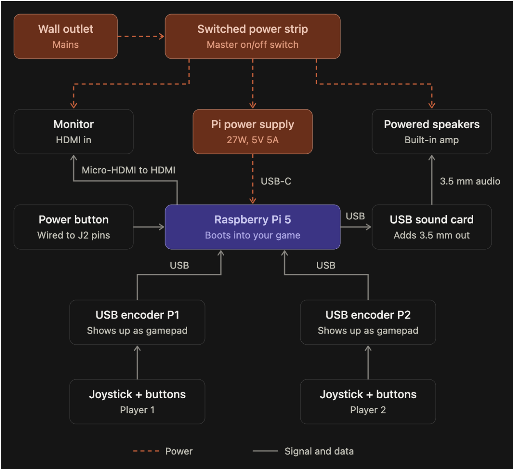

# Mad Science Gene Lab — 8-bit sprites

Sprites for an old-school side-scrolling arcade game targeting the Raspberry Pi 5.
All art is generated from Python: no image editor, just code.


## The cast

**Control group**: the "normal" ones.

| | |
|---|---|
| Tech Bro | Puffer vest, chinos, white sneakers, AirPods, eyes locked on his phone |
| Swamp Monster | Hunched, mossy, gill-slitted, dripping toxic slime |
| Sasquatch | Shaggy, cone-headed, knuckle-dragging |
| Banana Dude | A banana in shades and red sneakers. Thumbs up. |

**Kronenberg series**: DNA mashups. Each one is spliced from the *actual genes*
(legs / torso / head / arms) of the control group, plus a few lab-only genes
(tentacles, a flesh blob with a belly mouth, a brain in a jar, eyestalks, a crab
claw). Seams stay visible and get stitched shut. Optional mutations include extra
eyes, Frankenstein neck bolts, irradiated limbs, and a second head that faces backward.

## Animation states

Every character, including every random splice, gets all of these:

| State | Frames | FPS | Plays | Notes |
|---|---|---|---|---|
| `idle` | 4 | 4 | loop | breathing, blinks on the last frame |
| `walk` | 4 | 8 | loop | |
| `run` | 4 | 12 | loop | longer stride, leaning in, airborne passing frames |
| `jump` | 4 | 8 | by velocity | 0 crouch, 1 rising, 2 apex (knees tucked), 3 falling |
| `attack` | 4 | 12 | once | wind-up, strike, impact, recover. The hit lands on frame 2. |
| `hurt` | 2 | 10 | once | recoil, then white hit-flash |
| `death` | 6 | 8 | once, hold last | flash, then melts into a puddle of lab goo (one eyeball survives) |
| `crouch` | 2 | 12 | once, hold last | drop into a wide squat; held while DOWN is held, no walking |
| `interact` | 4 | 10 | once | reach, press, hold, recover. For doors and switches. |

Each species attacks in its own way. The move belongs to the arm, so a spliced
creature attacks however its front arm does:

* **Tech bro**: a point-blank phone camera flash
* **Swamp monster**: a slimy three-claw slash
* **Sasquatch**: an overhead ground-pound that kicks up dust
* **Banana dude**: a gloved haymaker, *POW*
* **Crab claw / tentacle** (lab genes): snap / whip-crack

The jump frames don't bake in any height. Move the sprite with your own physics
and choose the frame from vertical velocity. `Actor` in `sprites/viewer.py` is a
small state machine with no pygame dependency that does exactly this, so you can
copy it into the game.

## Setup

```bash
conda env create -f environment.yml
conda activate 8-bit
```

## Usage

Build every sprite sheet, the JSON atlas, and the preview GIFs and lineup:

```bash
python -m sprites.build
```

Add random Kronenbergs to the build (each seed always produces the same creature):

```bash
python -m sprites.build --mutants 12 --seed 500
```

Open the interactive viewer:

```bash
python -m sprites.viewer
```

| Action | Keyboard | Arcade stick |
|---|---|---|
| Walk | Left / Right (hold Shift to run) | stick left / right |
| Jump | Space or Z | button 0 |
| Attack | X | button 1 |
| Crouch (hold) | Down | stick down |
| Interact (doors, switches) | Up | stick up |
| Next character | Tab (Shift+Tab: previous) | |
| Splice a new mutant | M | button 3 |
| Take a hit / die | H / K | |
| Quit | Esc or Q | |

On the cabinet, `./play.sh` launches the game fullscreen on the monitor. It also works over SSH.

## Output format

```
assets/
  sprites/<slug>.png          sprite sheet: one row per state (order above), up to 6 frames per row
  sprites/atlas.json          row, frame count, fps and loop flag per state, plus recipe/mutations for mutants
  previews/<slug>.gif         every state in sequence, 6x scale
  previews/states/<slug>.png  labeled grid of every frame, 4x scale
  previews/lineup.png         the whole cast
```

* Every frame is **48×48**, facing **right**. To face left, flip the frame at runtime.
* Feet touch row 45 (`ground_row` in the atlas), so all characters share a baseline.
* Transparent background with a 1px dark outline.

## How it works

```
sprites/
  canvas.py        tiny pixel canvas: rect, oval, line, ASCII stamps, outline
  palette.py       limited color ramps per species
  rig.py           body plan (legs/torso/head/arms), poses, animation states
  effects.py       hit flash and goo melt
  species/         one module per creature; each exports its GENES
    kronenberg.py  the splicer, the random generator, and the curated specimens
    mutant_parts.py  lab-only genes
  characters.py    the roster
  build.py         exporter
  viewer.py        pygame-ce viewer
  font.py          3x5 pixel font
```

Each gene draws itself on its own layer, relative to anchor points the torso
exposes (neck, shoulder, hip). That's why any head fits on any body. Every
animation state is just a set of `Pose` values (stride, bob, lean, tuck, named arm
poses) in `rig.ANIMATIONS`. To add a state, add a row there and every creature
gets it.

To splice a specific creature:

```python
from sprites.species.kronenberg import splice
splice(legs="tentacle", torso="tech_bro", head="brain", front_arm="claw", eyes=2, bolts=True)
```

To add a new species, copy one of the modules in `species/` and give it four gene
classes. An arm needs `draw_swing`, `draw_limb` and, optionally, its own
`attack_fx`. Then register it in `characters.py` and `species/kronenberg.py`, and
it joins the gene pool automatically.

## Mini-games

Mini-games live in `minigames/`. Each one is built and tested on its own before
it joins the main game. Each uses the same canvas, palette, font and outline as
the cast, and the same 320×180 window and controls as the viewer.

### Stork Bomber

Fly the stork and drop the baby into the target strolling along the bottom of the
screen. Deliver 3 of 5 babies to win. The target speeds up after every delivery.
A dropped baby keeps the stork's momentum, so lead your shot. If it falls within
arm's reach of the target, the arms grab it, pull it in and eat it.

Once it's eaten a baby, the target chews on it while DNA helices swirl
around. A few seconds later it spits out a fully grown hairy man in a diaper. He
runs off the screen. He's built from rig genes like the rest of the cast
(`minigames/stork_bomber/hairy_man.py`), so he can join the roster later.
Babies that land on the target while it's chewing bounce off.

Deliver 3 babies in a row, with no misses or steals in between, and once the man
pops out, the target squirts all over the place. It sprays in pulses that splash
the stork and leave puddles on the floor for a few seconds. The streak shows
under the score. Tune it with `STREAK` and the `SQUIRT_*` constants.

Every so often the **Flying Spaghetti Monster** drifts in ("INCOMING PASTA!") and
chases the bundle for a few seconds. It's slower than the stork but turns well,
so keep moving. If its noodles reach the bundle, in the beak or falling, it steals
the baby and flies off with it. That baby is lost. Tune it with the `FSM_*`
constants at the top of `game.py`.

```bash
python -m minigames.stork_bomber             # windowed; add --fullscreen on the cabinet
python -m minigames.stork_bomber --demo      # the computer plays
```

| Action | Keyboard | Arcade stick |
|---|---|---|
| Fly | Arrows | stick |
| Drop the baby / start / continue | Space, Z or Enter | button 0 |
| Quit | Esc or Q | |

To plug a mini-game into the main game, drive the game object directly. Call
`update(dt, inp)` and `draw(screen)` every tick, and when `done` goes true, read
`result` (`"win"` or `"lose"`). `minigames/shell.py` describes the interface and
runs a mini-game standalone.

## Hardware



A Pi 5 runs on its 27 W supply. A switched power strip also powers the monitor
(micro-HDMI to HDMI) and the powered speakers, which take 3.5 mm audio from a USB
sound card. Each player's joystick and buttons connect to a USB encoder that the Pi
sees as a gamepad. A power button is wired to the J2 pins.

### Testing controllers

Plug in an encoder, then run:

```bash
python3 tools/controller_test.py
```

Every pad is listed with its axis, button and hat counts, and every input is
logged to the terminal. The window shows the stick position and a lamp for each
button. Add `--headless` to log without opening a window (for example, over SSH).

Work through this checklist:

1. Push the stick in all four directions and the diagonals. You should see axes 0/1 reach about ±1.00, or hat 0 change.
2. Press each button once. Each one should light a single lamp, and no two buttons should share an index. Write down which index each physical button gets, because the game's mapping will use those numbers.
3. Unplug the encoder and plug it back in. You should see `REMOVED` and then `ADDED`.

If something doesn't register:

* **No pad listed**: run `lsusb`. A zero-delay encoder shows up as `0079:0006 DragonRise`. If it's missing, try another cable or port.
* **One button is dead**: the microswitch wires go on **COM** and **NO**, not NC. Check that the harness is fully seated in the encoder.
* **Directions are swapped or mirrored**: the 5-pin joystick harness is plugged in rotated, or the stick is mounted turned. Either fix the hardware or flip it in the game's mapping.

To check below pygame, install the kernel-level tools with `sudo apt install joystick evtest`, then run `jstest /dev/input/js0`.

## Raspberry Pi 5

Raspberry Pi OS (Bookworm) ships Python 3.11, which is the same version as this
environment. You don't need conda on the Pi:

```bash
python3 -m venv .venv && . .venv/bin/activate && pip install pillow pygame-ce
```

The viewer renders at 320×180 and scales up. Use `--fullscreen` on the Pi.
