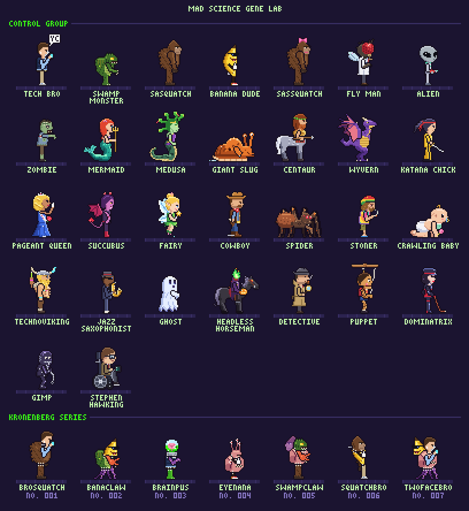
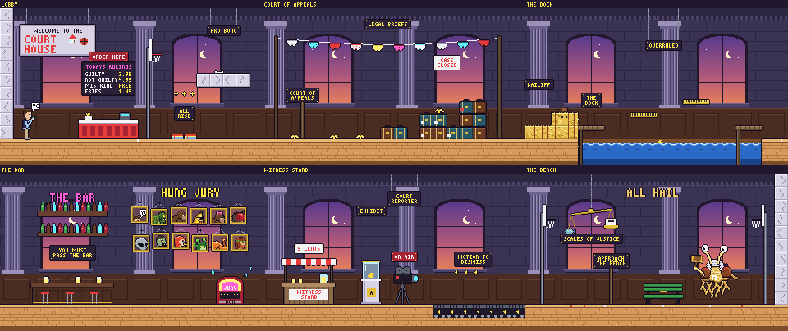
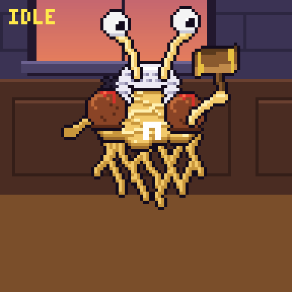
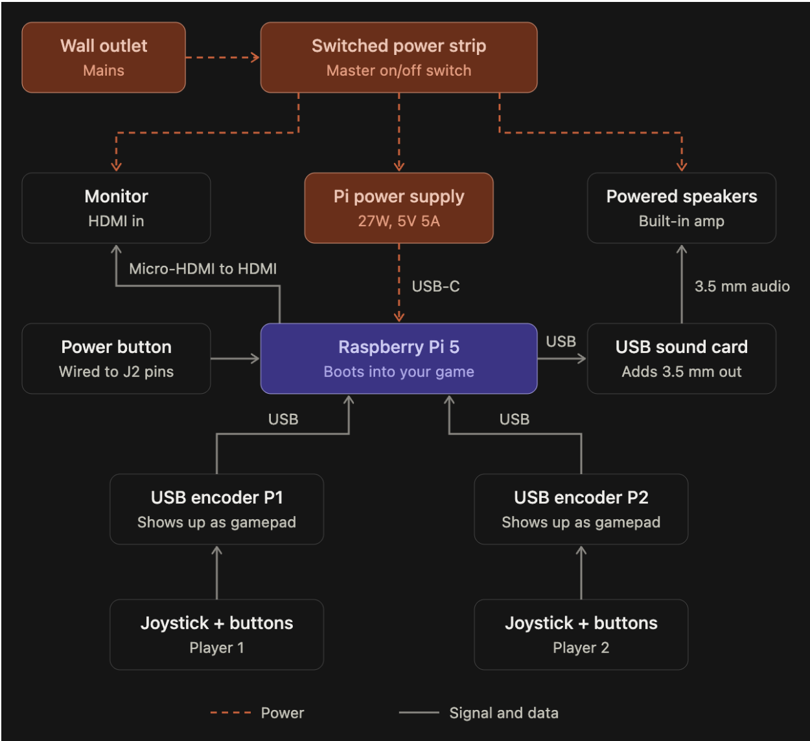

# Mad Science Gene Lab — 8-bit sprites

Sprites for an old-school side-scrolling arcade game targeting the Raspberry Pi 5.
All art is generated from Python: no image editor, just code.



## The cast

**Control group**: the "normal" ones.

| | |
|---|---|
| Tech Bro | Puffer vest, chinos, AirPods, phone held up to his face. Pitching YC at all times. |
| Swamp Monster | Hunched, mossy, gill-slitted, dripping toxic slime |
| Sasquatch | Shaggy, cone-headed, knuckle-dragging |
| Banana Dude | A banana in shades and red sneakers. Thumbs up. |
| Sassquatch | Sasquatch, plus a big pink bow, lashes and lipstick. Same knuckles. |
| Fly Man | Teleporter mishap. Lab coat, pocket pens, giant compound eyes. Spits digestive goo. |
| Alien | Little grey visitor in a silver jumpsuit. Huge black eyes, bigger ray gun. Comes in peace. Mostly. |
| Zombie | Grey-green, stitched up, shirt in tatters. Arms out, jaw slack, in no particular hurry. |
| Mermaid | Fish out of water. Hops around on her tail, trident always at the ready. |
| Medusa | Gorgon on a coiled serpent tail. Her hair bites. Don't make eye contact. |
| Giant Slug | A lab experiment that got out of hand. Glossy, orange, leaves a trail. Spits acid. |
| Centaur | Half hero, half dappled-grey horse. Laurel wreath, wild beard, spear. Four hooves, zero chill. |
| Wyvern | Purple, gold-bellied, horned, two legs and a pair of bat wings. Serious heartburn. |
| Katana Chick | Yellow jumpsuit, black ponytail, red headband, very sharp sword. Says nothing. Doesn't need to. |
| Pageant Queen | Big hair, tiara, sash, sequined gown. Waves at the crowd. Smiles through combat. |
| Succubus | Pocket-sized cartoon demon. Little horns, bat wings, spade tail. Blows kisses that hurt. |
| Fairy | Pocket-sized, glittery, buzzing. Leaf dress, hair bun, star wand. Never quite touches the floor. Sprays sparkles that sting. |
| Cowboy | Ten-gallon hat, red bandana, leather vest, spurs that jingle. Fastest draw in the lab. Blows the smoke off the barrel every time. |
| Spider | Red-kneed lab tarantula the size of a beagle. Eight hairy legs, a cluster of beady red eyes. Shoots webs. Nobody remembers ordering it. |
| Stoner | Rasta beanie, tie-dye tee, cargo shorts, flip-flops, half-lidded red eyes. Joint always lit. Attacks with a hotbox cloud, eventually. |
| Crawling Baby | Diapered infant on all fours, built entirely out of head. One curl, one pacifier, one rattle, zero fear. BONK. |
| Technoviking | A viking who took a wrong turn at the fjord and ended up at a rave. Horned helmet, braided beard, no shirt, ever. Points at you. The bass drops. |
| Jazz Saxophonist | Porkpie hat, shades, goatee, sharp suit. Never takes the sax out of his mouth. Plays the notes you don't hear, then the ones that hurt. |
| Ghost | Classic bedsheet ghost. Hollow eyes, stubby sheet-arms, a hem that never touches the floor. Says BOO, which is somehow enough. |
| Headless Horseman | Cloaked rider on a black horse with a burning red eye and a mane of smoke. Lost his head years ago. Throws flaming pumpkins about it. |
| Detective | Trench coat, collar up, fedora pulled low, pipe going. Carries a magnifying glass for clues and, more often, for setting things on fire. |
| Puppet | Wooden marionette in a painted red jacket. Ball joints, rosy cheeks, a nutcracker jaw that clacks. Nobody has ever seen who's holding the bar. |
| Dominatrix | Patent catsuit, red corset, peaked cap, thigh-high stilettos. Taps her whip, waiting. You will address her as Madam. |
| Gimp | Head-to-toe black leather, zippered hood, studded harness. Hunched, twitchy, swings his leash chain. Says "MMPH". |
| Stephen Hawking | The lab's resident genius. Tweed jacket, square glasses, a motorized chair with a speech computer. Pops wheelies. Opens black holes on request. |

**Kronenberg series**: DNA mashups. Each one is spliced from the *actual genes*
(legs / torso / head / arms) of the control group, plus a few lab-only genes
(tentacles, a flesh blob with a belly mouth, a brain in a jar, eyestalks, a crab
claw). Seams stay visible and get stitched shut. Optional mutations include extra
eyes, Frankenstein neck bolts, irradiated limbs, and a second head that faces backward.

## Animation states

Every character, including every random splice, gets all of these:

| State | Frames | FPS | Plays | Notes |
|---|---|---|---|---|
| `idle` | 4 | 4 | loop | breathing, blinks on the last frame |
| `walk` | 4 | 8 | loop | |
| `run` | 4 | 12 | loop | longer stride, leaning in, airborne passing frames |
| `jump` | 4 | 8 | by velocity | 0 crouch, 1 rising, 2 apex (knees tucked), 3 falling |
| `attack` | 4 | 12 | once | wind-up, strike, impact, recover. The hit lands on frame 2. |
| `hurt` | 2 | 10 | once | recoil, then white hit-flash |
| `death` | 6 | 8 | once, hold last | flash, then melts into a puddle of lab goo (one eyeball survives) |
| `crouch` | 2 | 12 | once, hold last | drop into a wide squat; held while DOWN is held, no walking |
| `interact` | 4 | 10 | once | reach, press, hold, recover. For doors and switches. |

Each species attacks in its own way. The move belongs to the arm, so a spliced
creature attacks however its front arm does:

* **Tech bro**: a point-blank phone camera flash
* **Swamp monster**: a slimy three-claw slash
* **Sasquatch**: an overhead ground-pound that kicks up dust
* **Banana dude**: a gloved haymaker, *POW*
* **Crab claw / tentacle** (lab genes): snap / whip-crack

The jump frames don't bake in any height. Move the sprite with your own physics
and choose the frame from vertical velocity. `Actor` in `sprites/viewer.py` is a
small state machine with no pygame dependency that does exactly this, so you can
copy it into the game.

## Setup

```bash
conda env create -f environment.yml
conda activate 8-bit
```

## Usage

Build every sprite sheet, the JSON atlas, and the preview GIFs and lineup:

```bash
python -m sprites.build
```

Add random Kronenbergs to the build (each seed always produces the same creature):

```bash
python -m sprites.build --mutants 12 --seed 500
```

Open the interactive viewer:

```bash
python -m sprites.viewer
```

| Action | Keyboard | Arcade stick |
|---|---|---|
| Walk | Left / Right (hold Shift to run) | stick left / right |
| Jump | Space or Z | button 0 |
| Attack | X | button 1 |
| Crouch (hold) | Down | stick down |
| Interact (doors, switches) | Up | stick up |
| Next character | Tab (Shift+Tab: previous) | |
| Splice a new mutant | M | button 3 |
| Take a hit / die | H / K | |
| Quit | Esc or Q | |

On the cabinet, `./play.sh` launches the game fullscreen on the monitor. It also works over SSH.

## Output format

```
assets/
  sprites/<slug>.png          sprite sheet: one row per state (order above), up to 6 frames per row
  sprites/atlas.json          row, frame count, fps and loop flag per state, plus recipe/mutations for mutants
  previews/<slug>.gif         every state in sequence, 6x scale
  previews/states/<slug>.png  labeled grid of every frame, 4x scale
  previews/lineup.png         the whole cast
```

* Every frame is **48×48**, facing **right**. To face left, flip the frame at runtime.
* Feet touch row 45 (`ground_row` in the atlas), so all characters share a baseline.
* Transparent background with a 1px dark outline.

## Level 1: The Court House



A courthouse, as described to someone who has never seen one. Every legal term
is taken completely literally:

| Zone | What's there |
|---|---|
| Lobby | The **court** is a basketball court. **ORDER HERE** is a fast-food counter (today's rulings: GUILTY 2.99, MISTRIAL FREE). **ALL RISE** legal pads launch you up to a **pro bono** dog bone. |
| Court of Appeals | Banana peels. Step on one and you skid. **Legal briefs** (underwear) dry on a clothesline. Climb the stacked **cases** (suitcases). |
| The Dock | A **bailiff** (a bale of hay in a sheriff's hat), an actual **dock** over actual water, and floating rulers marked **OVERRULED**. |
| The Bar | You must **pass the bar**. A **hung jury** of twelve cast portraits on strings. The **jury box** is a jukebox. |
| Witness Stand | A lemonade stand (5 cents). **Exhibit A** is a rubber duck under glass. The **court reporter** is a news camera, ON AIR. **Motion to dismiss** is a conveyor belt that pushes you back. |
| The Bench | A park bench. **Scales of justice**: a fish and a bathroom scale. Presiding: the Honorable Judge Spaghetti. |

**The boss.** The Honorable Judge Spaghetti is a Flying Spaghetti Monster in a
powdered barrister's wig and court bands. It has meatballs, eyes on noodly stalks,
a gavel in one noodly appendage, and a lot of dangling noodles to fly on. It drifts
over you and slams the gavel (ORDER!). Hit it six times and it collapses into a plate
of spaghetti with the wig on top. CASE DISMISSED.



| State | Frames | FPS | Plays |
|---|---|---|---|
| `idle` | 4 | 6 | loop (hover bob baked in) |
| `fly` | 4 | 10 | loop, noodles trailing |
| `attack` | 4 | 10 | once. The gavel lands on frame 2 at `attack_point`. |
| `hurt` | 2 | 10 | once, white flash on frame 1 |
| `death` | 6 | 6 | once, hold the last frame (plated) |

Bosses don't fit the 48×48 rig, so the judge has **80×80** frames, also facing right.
"ORDER!" isn't baked into the sprite because it would read backwards when flipped. Draw it in the engine.

Play it with any character (the controls are the viewer's, plus **R** to start over):

```bash
python -m sprites.play
```

The level output:

```
assets/levels/courthouse/
  far.png              wall, columns, windows. 160px wide, repeats; scroll at 0.5x
  level.png            everything else, 1920x192; scroll at 1x. The camera shows y=12..192
  spaghetti_judge.png  boss sheet, one row per state, 80x80 frames
  level.json           tile map, colliders, spawn, checkpoints, zones, boss animation table
```

`level.json` colliders are pixel rects with a `type`: `solid`, `oneway` (stand on
top, jump up through), `bounce` (launches you at `launch` px/s), `conveyor` (pushes
you at `push` px/s), `hazard` (banana peel) and `water`. `sprites/play.py` is a
small reference implementation of all of them. Its `World` class has no pygame
dependency. Rebuild just the level with `python -m sprites.levels.courthouse`.

## How it works

```
sprites/
  canvas.py        tiny pixel canvas: rect, oval, line, ASCII stamps, outline
  palette.py       limited color ramps per species
  rig.py           body plan (legs/torso/head/arms), poses, animation states
  effects.py       hit flash and goo melt
  species/         one module per creature; each exports its GENES
    kronenberg.py  the splicer, the random generator, and the curated specimens
    mutant_parts.py  lab-only genes
  characters.py    the roster
  bosses/          big characters that don't use the rig (Judge Spaghetti)
  levels/          one module per level: art, layout, colliders (The Court House)
  build.py         exporter
  viewer.py        pygame-ce viewer
  play.py          walk a level with any character
  font.py          3x5 pixel font
```

Each gene draws itself on its own layer, relative to anchor points the torso
exposes (neck, shoulder, hip). That's why any head fits on any body. Every
animation state is just a set of `Pose` values (stride, bob, lean, tuck, named arm
poses) in `rig.ANIMATIONS`. To add a state, add a row there and every creature
gets it.

To splice a specific creature:

```python
from sprites.species.kronenberg import splice
splice(legs="tentacle", torso="tech_bro", head="brain", front_arm="claw", eyes=2, bolts=True)
```

To add a new species, copy one of the modules in `species/` and give it four gene
classes (or fewer: Sassquatch only donates a new head). An arm needs `draw_swing`,
`draw_limb` and, optionally, its own `attack_fx`. Put its colors in `palette.py`,
then add it to `CONTROL_GROUP` in `characters.py` and to `DONORS` in
`species/kronenberg.py`, and it joins the gene pool automatically. Random splices
that would poke out of the 48x48 frame (a tall head on a tall body) get rerolled,
so a seed still always gives the same creature.

## Mini-games

Mini-games live in `minigames/`. Each one is built and tested on its own before
it joins the main game. Each uses the same canvas, palette, font and outline as
the cast, and the same 320×180 window and controls as the viewer.

### Stork Bomber

Fly the stork and drop the baby into the target strolling along the bottom of the
screen. Deliver 3 of 5 babies to win. The target speeds up after every delivery.
A dropped baby keeps the stork's momentum, so lead your shot. If it falls within
arm's reach of the target, the arms grab it, pull it in and eat it.

Once it's eaten a baby, the target chews on it while DNA helices swirl
around. A few seconds later it spits out a fully grown hairy man in a diaper. He
runs off the screen. He's built from rig genes like the rest of the cast
(`minigames/stork_bomber/hairy_man.py`), so he can join the roster later.
Babies that land on the target while it's chewing bounce off.

Deliver 3 babies in a row, with no misses or steals in between, and once the man
pops out, the target squirts all over the place. It sprays in pulses that splash
the stork and leave puddles on the floor for a few seconds. The streak shows
under the score. Tune it with `STREAK` and the `SQUIRT_*` constants.

Every so often the **Flying Spaghetti Monster** drifts in ("INCOMING PASTA!") and
chases the bundle for a few seconds. It's slower than the stork but turns well,
so keep moving. If its noodles reach the bundle, in the beak or falling, it steals
the baby and flies off with it. That baby is lost. Tune it with the `FSM_*`
constants at the top of `game.py`.

```bash
python -m minigames.stork_bomber             # windowed; add --fullscreen on the cabinet
python -m minigames.stork_bomber --demo      # the computer plays
```

| Action | Keyboard | Arcade stick |
|---|---|---|
| Fly | Arrows | stick |
| Drop the baby / start / continue | Space, Z or Enter | button 0 |
| Quit | Esc or Q | |

### Primordial Soup

A play on the primordial soup theory of how life began. The lab's critters have
escaped into the kitchen, and you play the chef. Catch 4 of them and throw them
in the stockpot before the 45-second clock on the wall runs out. The game is seen
from above, arcade-style, in a room that's half kitchen and half mad-science lab.

Each round 7 critters get loose, picked from 10 kinds:
- an eyeball in a top hat
- a fish on human legs in sneakers
- an amoeba with a moustache
- a brain in a propeller beanie
- a jello cube
- a screaming egg
- an angry hot dog
- a trilobite in shades
- a walking wiener
- a little vulva in red sneakers (the Stork Bomber target's cousin)

The jello, egg and wiener hop. They flee when you get close, dodge along the
walls, and stop to taunt you from across the room ("NYAH!"). Each kind has its
own lines when you grab it.

Pounce on a critter to grab it, then throw it. Throw it toward the pot from close
enough and it lands in. Wild throws from further away can still drop in, or
clang off the side. The room fights back:
- **Tesla coil:** every few seconds it arcs to whoever's closest. It might be
  you (dazed, and you drop your critter), a critter (fried and stunned for a
  while) or a coworker.
- **Wall rack:** a tool rattles and flies at you, with a red ring marking where
  it'll land. One of the tools is a dildo. Don't ask.
- **Staff:** a sous-chef with a tray, a mad scientist with a bubbling flask, and
  an intern whose hair is on fire wander around. They shove you if you're in the
  way, and if the intern runs into you, you drop your critter.
- **Grease:** slicks make you slide. The chef otherwise has tight arcade
  controls and stops dead when you let go.

The rest is decoration: a brain blinking in the specimen tank, a critter (or the
dildo) spinning in the microwave under the "NO DILDOS IN THE MICROWAVE" note,
steam puffing from the pipes, a blinking control panel, and a penis in one of
the specimen jars.

**Win:** the soup comes alive. It boils, rises out of the pot as a slime monster
with too many eyes, leaps on the chef and digests him. Then it puts on his hat
and trashes the kitchen, eating any critters and staff it lands on and knocking
tools and plates everywhere.

**Lose:** the diners burst through the door wanting their soup. They surround
the chef and stab him to death with forks and steak knives until he melts into
goo.

The chef, staff and diners are rig characters like the cast
(`minigames/primordial_soup/people.py`), so they have every animation state.
The diners come in six looks. Tune the game with the constants at the top of
`minigames/primordial_soup/game.py`: `NEED`, `TIME_LIMIT`, `AIM_RANGE`, and the
`CRIT_*`, `TESLA_*`, `STAFF_*`, `TOOL_*` and `PERSONALITY` groups.

```bash
python -m minigames.primordial_soup            # windowed; add --fullscreen on the cabinet
python -m minigames.primordial_soup --demo     # the computer plays
```

| Action | Keyboard | Arcade stick |
|---|---|---|
| Run around | Arrows | stick |
| Pounce / throw / start / continue | Space, Z or Enter | button 0 |
| Quit | Esc or Q | |

### Womb Rave

A rhythm game. It opens in a dark gallery with a big pink sculpture of a womb
(*Untitled ('Home')*, mixed media), with tubes and ovaries curling up like ram's
horns. Your character walks up to the door at its foot, which dilates, and gets
slurped in. Inside, they float in an amniotic sac in the middle of the womb and
dance to the mother's heartbeat.

Things come at the membrane around the sac along four lanes, and each lane is
a part of the womb:

| Lane | What comes down it | Hit |
|---|---|---|
| Left / right | eggs rolling down the fallopian tubes from the ovaries | stick left / right |
| Up | mom's cravings (pickles, ice cream, pizza, donuts) sliding down the umbilical cord from the placenta | stick up |
| Down | sperm swimming up from the cervix | stick down |
| Squeeze | a contraction: a ring of flesh closes in from the walls | button |

Hit each one as it touches the membrane. Stick diagonals hit two lanes at once.
Every hit makes the dancer move: a step left or right, a hop, a squat, or their
species attack on a squeeze. The whole room keeps time. The flesh tunnel throbs
on every lub-dub, squeezes on every contraction, and club lights sweep the walls
in the choruses.

The soundtrack is a 120 BPM chiptune generated from code, like the art
(`minigames/womb_rave/music.py`). The kick is a heartbeat, the lead plays exactly
on the stick notes, and every squeeze has a contraction *womp* baked in. The
chart is dealt from a fixed seed, so it's the same every time and can be learned.
The song runs through the first, second and third trimester, a contractions
breakdown and a final PUSH, about 45 seconds in all.

Hits are judged PERFECT, GREAT or OK. Each one fills your vitals and builds the
combo; each miss drains them.

**Win:** finish the song. Your water breaks, you slide out the bottom, and the
sculpture shoots you back into the gallery in a shower of pink and blue
confetti: *IT'S A TECH BRO!* You get a grade (S to D) from how in sync you were.

**Lose:** your vitals run out. The record scratches, the lights go red, and the
womb evicts you. You land on the gallery floor with a thud.

Any cast member can go in. By default it's someone random from the control
group. Tune it with the constants at the top of `minigames/womb_rave/game.py`:
`APPROACH` (how long notes take to arrive), `WINDOWS` (timing windows), the
`LIFE_*` values, and `AUDIO_LAG`. If every hit feels early or late on the
cabinet's speakers, adjust `AUDIO_LAG`. To change the song or the chart, edit
`SECTIONS` and `PATTERNS` in `music.py`.

```bash
python -m minigames.womb_rave                          # windowed; add --fullscreen on the cabinet
python -m minigames.womb_rave --character technoviking  # pick who goes in
python -m minigames.womb_rave --demo                   # the computer plays
```

| Action | Keyboard | Arcade stick |
|---|---|---|
| Dance (left, right, up, down) | Arrows | stick |
| Squeeze / start / continue | Space, Z or Enter | button 0 |
| Quit | Esc or Q | |

To plug a mini-game into the main game, drive the game object directly. Call
`update(dt, inp)` and `draw(screen)` every tick, and when `done` goes true, read
`result` (`"win"` or `"lose"`). `minigames/shell.py` describes the interface and
runs a mini-game standalone.

## Hardware



A Pi 5 runs on its 27 W supply. A switched power strip also powers the monitor
(micro-HDMI to HDMI) and the powered speakers, which take 3.5 mm audio from a USB
sound card. Each player's joystick and buttons connect to a USB encoder that the Pi
sees as a gamepad. A power button is wired to the J2 pins.

### Testing controllers

Plug in an encoder, then run:

```bash
python3 tools/controller_test.py
```

Every pad is listed with its axis, button and hat counts, and every input is
logged to the terminal. The window shows the stick position and a lamp for each
button. Add `--headless` to log without opening a window (for example, over SSH).

Work through this checklist:

1. Push the stick in all four directions and the diagonals. You should see axes 0/1 reach about ±1.00, or hat 0 change.
2. Press each button once. Each one should light a single lamp, and no two buttons should share an index. Write down which index each physical button gets, because the game's mapping will use those numbers.
3. Unplug the encoder and plug it back in. You should see `REMOVED` and then `ADDED`.

If something doesn't register:

* **No pad listed**: run `lsusb`. A zero-delay encoder shows up as `0079:0006 DragonRise`. If it's missing, try another cable or port.
* **One button is dead**: the microswitch wires go on **COM** and **NO**, not NC. Check that the harness is fully seated in the encoder.
* **Directions are swapped or mirrored**: the 5-pin joystick harness is plugged in rotated, or the stick is mounted turned. Either fix the hardware or flip it in the game's mapping.

To check below pygame, install the kernel-level tools with `sudo apt install joystick evtest`, then run `jstest /dev/input/js0`.

## Raspberry Pi 5

Raspberry Pi OS (Bookworm) ships Python 3.11, which is the same version as this
environment. You don't need conda on the Pi:

```bash
python3 -m venv .venv && . .venv/bin/activate && pip install pillow pygame-ce
```

The viewer and `sprites.play` render at 320×180 and scale up. Use `--fullscreen` on the Pi.
