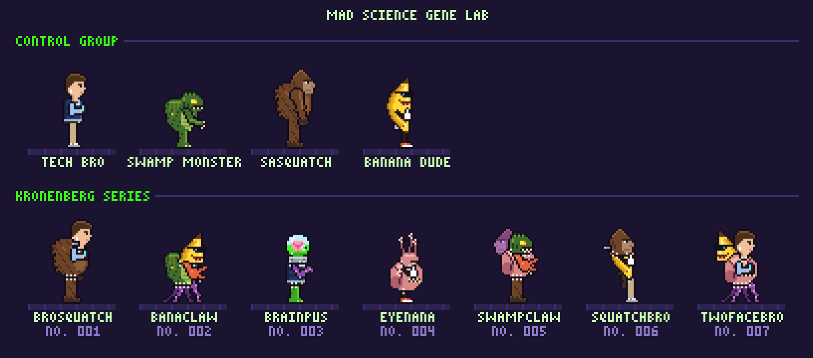

# Mad Science Gene Lab — 8-bit sprites

Sprites for an old-school side-scrolling arcade game targeting the Raspberry Pi 5.
All art is generated from Python: no image editor, just code.



## The cast

**Control group**: the "normal" ones.

| | |
|---|---|
| Tech Bro | Puffer vest, chinos, white sneakers, AirPods, eyes locked on his phone |
| Swamp Monster | Hunched, mossy, gill-slitted, dripping toxic slime |
| Sasquatch | Shaggy, cone-headed, knuckle-dragging |
| Banana Dude | A banana in shades and red sneakers. Thumbs up. |

**Kronenberg series**: DNA mashups. Each one is spliced from the *actual genes*
(legs / torso / head / arms) of the control group, plus a few lab-only genes
(tentacles, a flesh blob with a belly mouth, a brain in a jar, eyestalks, a crab
claw). Seams stay visible and get stitched shut. Optional mutations include extra
eyes, Frankenstein neck bolts, irradiated limbs, and a second head that faces backward.

## Animation states

Every character, including every random splice, gets all of these:

| State | Frames | FPS | Plays | Notes |
|---|---|---|---|---|
| `idle` | 4 | 4 | loop | breathing, blinks on the last frame |
| `walk` | 4 | 8 | loop | |
| `run` | 4 | 12 | loop | longer stride, leaning in, airborne passing frames |
| `jump` | 4 | 8 | by velocity | 0 crouch, 1 rising, 2 apex (knees tucked), 3 falling |
| `attack` | 4 | 12 | once | wind-up, strike, impact, recover. The hit lands on frame 2. |
| `hurt` | 2 | 10 | once | recoil, then white hit-flash |
| `death` | 6 | 8 | once, hold last | flash, then melts into a puddle of lab goo (one eyeball survives) |

Each species attacks in its own way. The move belongs to the arm, so a spliced
creature attacks however its front arm does:

* **Tech bro**: a point-blank phone camera flash
* **Swamp monster**: a slimy three-claw slash
* **Sasquatch**: an overhead ground-pound that kicks up dust
* **Banana dude**: a gloved haymaker, *POW*
* **Crab claw / tentacle** (lab genes): snap / whip-crack

The jump frames don't bake in any height. Move the sprite with your own physics
and choose the frame from vertical velocity. `Actor` in `sprites/viewer.py` is a
small state machine with no pygame dependency that does exactly this, so you can
copy it into the game.

## Setup

```bash
conda env create -f environment.yml
conda activate 8-bit
```

## Usage

Build every sprite sheet, the JSON atlas, and the preview GIFs and lineup:

```bash
python -m sprites.build
```

Add random Kronenbergs to the build (each seed always produces the same creature):

```bash
python -m sprites.build --mutants 12 --seed 500
```

Open the interactive viewer. **Arrows** walk (hold **Shift** to run), **Space** jumps,
**X** attacks, **H** takes a hit, **K** dies, **Up/Down** swaps characters, and **M** splices a new mutant:

```bash
python -m sprites.viewer
```

## Output format

```
assets/
  sprites/<slug>.png          sprite sheet: one row per state (order above), up to 6 frames per row
  sprites/atlas.json          row, frame count, fps and loop flag per state, plus recipe/mutations for mutants
  previews/<slug>.gif         every state in sequence, 6x scale
  previews/states/<slug>.png  labeled grid of every frame, 4x scale
  previews/lineup.png         the whole cast
```

* Every frame is **48×48**, facing **right**. To face left, flip the frame at runtime.
* Feet touch row 45 (`ground_row` in the atlas), so all characters share a baseline.
* Transparent background with a 1px dark outline.

## How it works

```
sprites/
  canvas.py        tiny pixel canvas: rect, oval, line, ASCII stamps, outline
  palette.py       limited color ramps per species
  rig.py           body plan (legs/torso/head/arms), poses, animation states
  effects.py       hit flash and goo melt
  species/         one module per creature; each exports its GENES
    kronenberg.py  the splicer, the random generator, and the curated specimens
    mutant_parts.py  lab-only genes
  characters.py    the roster
  build.py         exporter
  viewer.py        pygame-ce viewer
  font.py          3x5 pixel font
```

Each gene draws itself on its own layer, relative to anchor points the torso
exposes (neck, shoulder, hip). That's why any head fits on any body. Every
animation state is just a set of `Pose` values (stride, bob, lean, tuck, named arm
poses) in `rig.ANIMATIONS`. To add a state, add a row there and every creature
gets it.

To splice a specific creature:

```python
from sprites.species.kronenberg import splice
splice(legs="tentacle", torso="tech_bro", head="brain", front_arm="claw", eyes=2, bolts=True)
```

To add a new species, copy one of the modules in `species/` and give it four gene
classes. An arm needs `draw_swing`, `draw_limb` and, optionally, its own
`attack_fx`. Then register it in `characters.py` and `species/kronenberg.py`, and
it joins the gene pool automatically.

## Raspberry Pi 5

Raspberry Pi OS (Bookworm) ships Python 3.11, which is the same version as this
environment. You don't need conda on the Pi:

```bash
python3 -m venv .venv && . .venv/bin/activate && pip install pillow pygame-ce
```

The viewer renders at 320×180 and scales up. Use `--fullscreen` on the Pi.
